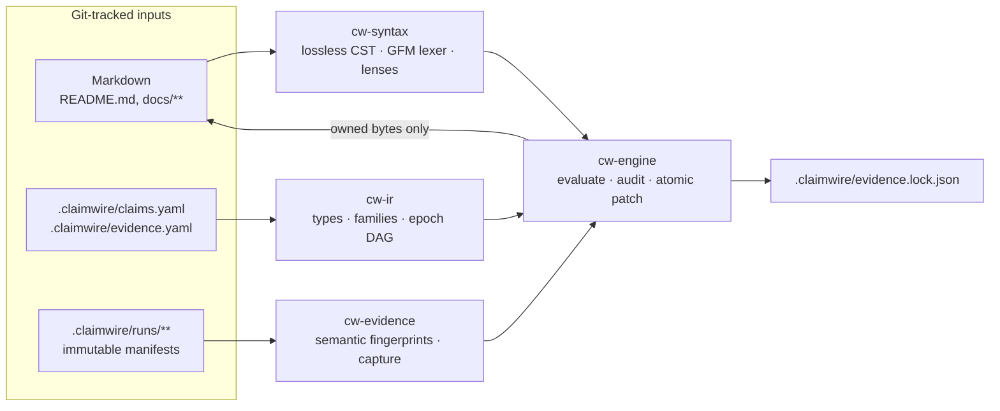

<div align="center">

# Claim Wire

**An incremental compiler for evidence-backed documentation.**

Claim Wire treats the numbers in your Markdown as build targets. Each one is typed, traceable to the run that produced it, and rebuilt only when its inputs actually change.

[-brightgreen)](#roadmap)
[](spec.md)
[](#license)
[](#two-phases-probabilistic-discovery-deterministic-maintenance)

[Why](#why) · [How it works](#how-it-works) · [Tour](#a-quick-tour) · [Guarantees](#guarantees) · [CLI](#cli) · [Roadmap](#roadmap) · [**Spec**](spec.md)

</div>

> [!NOTE]
> **Claim Wire `v0.4` is implemented across all five workspace crates (`cw-syntax`, `cw-ir`, `cw-evidence`, `cw-engine`, `cw-cli`).** The normative design lives in [`spec.md`](spec.md), and the 10-point acceptance suite runs end-to-end against [`tests/fixtures/magnetar/`](tests/fixtures/magnetar/).

---

## The bug this is built to catch

Here is a real repository, a Rust/Python zero-knowledge prover, checked at commit `f8382f3`. Three documents state how many Python reference tests exist:

| Location | Says |
|---|---|
| `README.md:18` | `(362 Rust, 227 Python, 46 ISA tests)` |
| `docs/BENCHMARKS.md:185` | `227 tests, 0 failures` |
| `docs/spec/15-testing.md:19` | `(192 tests, about one minute)` |

The suite has 227 tests. Nobody lied; one sentence was simply forgotten. Multiply that by every latency, proof size, speedup ratio, and soundness bound in a serious systems repository, and the docs slowly stop being true.

Once those three locations are wired to one claim, `cw check` turns the drift into a build error:

```text
$ cw check
error[CW3003]: Markdown value out of sync with claim `inventory.python_tests`
  --> docs/spec/15-testing.md:19:39
   |
19 |    (<!-- cw:inventory.python_tests -->192<!-- /cw --> tests, about one minute).
   |                                       ^^^ evidence says 227
   |
   = evidence: om.inventory@current · run inventory-20261016 · commit f8382f3
   = also rendered at: README.md:18           (block readme.test_suite_comment) ✓
                       docs/BENCHMARKS.md:185 (table bench.test_suites)        ✓
   = help: run `cw sync` to rewrite this span from evidence

error: 1 of 92 registered locations failed verification
```

```text
$ cw sync
patched  docs/spec/15-testing.md:19   inventory.python_tests   192 → 227
1 file written · .claimwire/evidence.lock.json updated
```

The fix is deterministic, takes milliseconds, and calls no model.

---

## Why

Repositories that publish numbers usually fail in one of two ways.

**Silent drift.** You update the main table in `docs/BENCHMARKS.md` but miss the same latency in two other tables and in a throughput sentence in `README.md`. Every copy of a number is another place for it to go stale.

**Unconstrained AI rewriting.** You give an LLM a CI job and ask it to "keep the docs updated." It has no formal idea of what a *valid* update is. It either commits thermal noise as real change, or, much worse, it handles a regression by quietly rewording *"ahead of the paper's 599 KiB bound"* into *"comparable to the paper's bound."*

Claim Wire avoids both. You don't need a model rewriting prose on every commit, and you don't need to turn readable Markdown into a template language. You need **factual claims to be first-class build targets** with a typed dependency and provenance graph behind them.

---

## How it works

For every tracked statement, Claim Wire answers three narrow questions:

| | Question | Direction |
|---|---|---|
| **Provenance** | Where did this rendered value come from, and how was it computed? | backward (audit) |
| **Invalidation** | Which upstream inputs changed in a way that requires re-evaluating it? | forward (incremental build) |
| **Policy** | When evidence changes or a condition fails, may the value be rewritten in place, or must the build halt? | gate |

The first two look alike, but they run in opposite directions through the graph:

```text
Provenance (backward / audit)
  README span "~491k cycles/s"
    → derivation           cycles / prove_wall
    → scoped observation   workload=radix-sort-u64, profile=test, prove_wall=8.5487 s
    → immutable manifest   runs/om.benchmarks/bench-20261016-m4pro.json  (commit 9872a7e, Apple M4 Pro)

Invalidation (forward / incremental)
  crates/om-spartan/src/lib.rs edited
    → semantic input digest mismatch
    → producer om.benchmarks@current is stale
    → claim family guest_bench[*, *]
    → 1 table + 2 spans in README.md, 5 tables in docs/BENCHMARKS.md
```

### Avoiding the Git-SHA trap

Keying freshness on `HEAD` doesn't work. Committing the updated `README.md` changes the SHA and makes your benchmark look stale again. Fixing a typo in a doc comment changes file bytes without changing the binary.

Claim Wire records the Git SHA for **provenance** only. **Freshness** comes from a `blake3` fingerprint of each producer's declared inputs, computed over a *semantic* token stream with comments stripped and whitespace canonicalized by a language-aware lexer. The normalizer is allowed to over-invalidate but must never under-invalidate. `cargo fmt` won't force a 10-minute benchmark rerun, and a real code change always will.

---

## A quick tour

> Target UX from the spec. Syntax is normative in [`spec.md`](spec.md) §4–§6.

### 1. Mark up Markdown, but leave it readable

Most quantitative claims live in tables, so a **single comment** above an ordinary GFM table binds the whole table. Mapped cells contain no inline HTML:

```markdown
<!-- cw:table readme.benchmarks -->
| Guest | Cycles (`T`) | Profile | Prove | Peak RSS | Verify | Proof Size |
|---|---:|---|---:|---:|---:|---:|
| `fib(19)` | `2^8` | test | 0.02 s | 16 MiB | 10 ms | 23,526 B |
| `fib(19)` | `2^8` | provable-120 | 0.02 s | 23 MiB | 20 ms | 83,654 B |
| `radix-sort-u64` (`A = 17`) | `2^22` | test | **8.55 s** | 8.3 GiB | 10 ms (27 MiB) | 60,806 B |
| `radix-sort-u64` (`A = 17`) | `2^22` | provable-120 | **8.82 s** | 8.4 GiB | 50 ms (48 MiB) | 603,942 B (589.8 KiB) |
```

Numbers in prose use a short inline span:

```markdown
At `T = 2^22`, throughput is **<!-- cw:guest_bench[radix-sort-u64, test].throughput -->~491k cycles/s<!-- /cw -->** (`test`).
```

HTML comments inside a fenced code block would render as visible text, so a **block lens** sits *above* the block and matches an invertible line pattern instead:

````markdown
<!-- cw:block readme.test_suite_comment -->
```sh
# Run Rust, Python, and RV64I conformance + fuzz suites (362 Rust, 227 Python, 46 ISA tests)
cargo test --workspace --release
```
````

### 2. Declare each fact once, as a typed family

You don't write 270 scalar stanzas for 15 workloads × 2 profiles × 9 metrics. You declare one **claim family**:

```yaml
# .claimwire/claims.yaml
families:
  guest_bench:
    producer: om.benchmarks
    dimensions: [workload, profile]
    metrics:
      cycles:     { type: Cycles,   format: "{:,}" }
      prove_wall: { type: Duration, format: "{:.2f s}", deadband: 2.5% }
      proof_size: { type: Bytes,    format: "{:, B}" }          # deterministic: 0% deadband
    derivations:
      throughput:
        type: Throughput
        expr: "cycles / prove_wall"                              # Cycles / Duration → Throughput
        format: "~{:.0fk cycles/s}"
      speedup_vs_initial:
        type: Ratio
        expr: "guest_bench@initial[workload, test].prove_wall / prove_wall"
        format: "{:.1f×}"

assertions:
  check.proof_ahead_of_paper:
    expr: "guest_bench[radix-sort-u64, provable-120].proof_size <= paper.t22.proof_size_max"
```

### 3. Capture evidence from any harness, with no SDK

Benchmarks print single-line frames, and `cw capture` writes an immutable, fingerprinted run manifest:

```text
$ cw capture --producer om.benchmarks -- cargo run -p om-bench --release -- --emit-cw
@cw:record family="guest_bench" workload="radix-sort-u64" profile="test" cycles=4194304 prove_wall="8.5487s" proof_size="60806B"
...
captured 42 records (30 guest_bench, 12 phase_bench) → .claimwire/runs/om.benchmarks/bench-20261016-m4pro.json  (@current)
```

### 4. Check in CI, sync locally, explain anything

```text
$ cw explain README.md:53
README.md:53  "~491k cycles/s"
└─ guest_bench[radix-sort-u64, test].throughput = cycles / prove_wall
   ├─ cycles     = 4,194,304   ← om.benchmarks@current
   └─ prove_wall = 8.5487 s    ← om.benchmarks@current
      run     bench-20261016-m4pro  (Apple M4 Pro, 14-core, 24 GiB)
      commit  9872a7e  (clean)
      inputs  blake3:7f83b165…  fresh
```

---

## Design highlights

| Mechanism | What it solves |
|---|---|
| **Table lenses**: `records`, `transposed`, `checklist` | Relational tables, metric-per-row pivot tables, and heterogeneous verification tables, all bound by one comment. Bold, code ticks, unmapped prose columns, and sentinel cells (`—`, `N/A`, `exact`) are preserved. |
| **GFM-conformant lexing** | Cells are split exactly as GitHub splits them, so `cw` never edits a cell that doesn't exist on the rendered page. Unescaped pipes inside code spans are flagged (`CW1008`). This catches a real rendering bug in the test repo. |
| **Claim families & reductions** | `sum`, `min`, `max`, subsets (`sum(phase_bench[{ram_twist, register_twist}].duration)`), and ordered `prefix_sum` for cumulative "ends at" columns. |
| **Dimensional types** | `Cycles / Duration → Throughput` type-checks. `Duration + Count` is a compile error (`CW2001`). Units live inside format specs, so `ns` can never be printed as `s`. |
| **Named evidence epochs** | `@current`, `@prev`, and `@initial` make optimization stories (`107 s → 20.7 s → 8.55 s`, `12.5×`) derived values instead of magic constants. |
| **No silent weakening** | `assert` guards block publication. A proof that grows past the paper's bound fails `CW3002`; nobody rewords it. |
| **Deadband hysteresis** | Timings may declare `±2.5%` so thermal noise doesn't churn `git log`. Held values propagate to derived numbers, and assertions always see fresh data. |
| **Context anchoring** | If someone edits `At T = 2^22` to `At T = 2^24` around an untouched span, `CW4002` flags that the prose and the binding now disagree. |
| **Honest coverage** | `cw check` reports what it verified and states what it didn't: *"Unregistered prose outside Claim Wire spans, tables, and blocks was not assessed."* |

---

## Guarantees

The spec makes five invariants non-negotiable (§2.2):

| Invariant | Meaning |
|---|---|
| **Idempotence** | Running `cw sync` twice on unchanged inputs writes zero bytes. |
| **Non-interference** | Only owned spans, mapped cells, and matched block slots are ever modified. Everything else, including whitespace and line endings, is preserved byte-for-byte. |
| **No silent weakening** | A failing assertion halts the build. `cw` never publishes the broken value and never relaxes the predicate. |
| **Single-rounding determinism** | Derivations run on unrounded canonical values. Rounding (`half_to_even`) happens exactly once, at display. |
| **Crash-safe transactions** | Multi-file patches and lockfile updates commit atomically through a write-ahead journal. |

---

## Two phases: probabilistic discovery, deterministic maintenance

Models are good at finding claims and bad at being invariants, so Claim Wire keeps them out of the loop that has to be correct.

| Phase | Tool | Nature | Job |
|---|---|---|---|
| **1. Discovery** | `claim-wire` agent skill | Probabilistic, human-reviewed, one-off | Scan docs and harnesses, deduplicate numbers shared across files, propose `.claimwire/*.yaml` and lenses, repair `CWxxxx` diagnostics. |
| **2. Maintenance** | `cw` (Rust) | Deterministic, offline, every commit | Parse losslessly, type-check, verify fingerprints and assertions, patch owned spans transactionally. |

---

## How it compares

| | Hand-maintained | Template generators<br/>(`README.md.tera`) | LLM doc bots | **Claim Wire** |
|---|:---:|:---:|:---:|:---:|
| Source stays plain, readable Markdown | ✅ | ❌ | ✅ | ✅ |
| One number, many locations, one source of truth | ❌ | ✅ | ❌ | ✅ |
| Knows *which* claims a code change invalidated | ❌ | ❌ | ❌ | ✅ |
| Refuses to weaken a claim to match a regression | — | — | ❌ | ✅ |
| Deterministic and offline in CI | ✅ | ✅ | ❌ | ✅ |
| Full provenance from rendered bytes to run manifest | ❌ | ❌ | ❌ | ✅ |
| Detects hand edits and drifted surrounding prose | ❌ | ❌ | ❌ | ✅ |

---

## CLI

Install the `cw` binary locally from the workspace:

```bash
cargo install --path crates/cw-cli
```

`cw` automatically walks parent directories to locate `.claimwire/` (or accepts `-C <dir>`), auto-detects terminal color support (`--color auto|always|never` and `NO_COLOR`), and provides per-subcommand `--help` and typo suggestions.

| Command | Purpose |
|---|---|
| `cw init [--force] [--git]` | Scaffold `.claimwire/evidence.yaml`, `.claimwire/claims.yaml`, `.claimwire/runs/`, `.gitignore`, and optional Git merge driver config. |
| `cw scan [<file…>]` | Scan Markdown files for wired/unwired GFM tables, code blocks, inline spans, and `CW1008` unescaped pipe issues. |
| `cw adopt [<file…>]` | Reverse-parse existing Markdown through bidirectional formats to bootstrap `evidence.lock.json`, with zero byte changes. |
| `cw status` | Workspace health dashboard: producer freshness, latest run manifests, claim/assertion counts, and per-file Markdown sync status. |
| `cw list [producers\|families\|claims\|assertions\|locations]` | Inspect declared producers, families, evaluated scalar claims, assertions, or bound Markdown coordinates. |
| `cw check [--format human\|json\|github\|sarif]` | Read-only verification of syntax, types, scopes, freshness, assertions, and Markdown ↔ lockfile agreement. |
| `cw sync [--dry-run] [--diff] [--exact] [--force] [--ack-context]` | Re-evaluate claims and transactionally patch owned spans, cells, and blocks (or preview unified diffs with `--dry-run --diff`). |
| `cw capture --producer <id> -- <cmd…>` | Run a harness, ingest `@cw:record` frames, and write an immutable, fingerprinted run manifest. |
| `cw impact [<path…> \| --git-diff <rev>]` | Trace changed files forward to affected producers, claims, and exact `file:line` locations. |
| `cw explain <claim \| file:line \| CWxxxx>` | Print the full provenance tree for any rendered value, or display the reference explanation for any diagnostic code (`cw explain CW1008`). |
| `cw diff <rev1>..<rev2>` | Classify claim changes across revisions: value, definition, scope, evidence refresh, or assertion regression. |
| `cw merge-driver %O %A %B` | Git merge driver that resolves lockfile and wired-Markdown conflicts structurally. |
| `cw completions <bash\|zsh\|fish>` | Generate shell completion scripts for `bash`, `zsh`, or `fish`. |

Diagnostics are grouped by stage: `CW1xxx` syntax, `CW2xxx` types and scope, `CW3xxx` verification and freshness, `CW4xxx` conflicts and context. See [spec §9.3](spec.md#93-diagnostic-code-taxonomy) or run `cw explain CWxxxx`.

---

## Architecture



Planned workspace layout:

```text
claim-wire/
├── spec.md              # Normative specification (v0.4) ← exists today
├── crates/
│   ├── cw-syntax/       # Lossless Markdown CST, GFM-conformant table lexer, block & format parser
│   ├── cw-ir/           # Dimensional type checker, family/reduction expander, scope & epoch DAG
│   ├── cw-evidence/     # Semantic fingerprinter, epoch manifest loader, @cw: capture
│   ├── cw-engine/       # Evaluator, deadband/sentinel handling, conflict auditor, transactional patcher
│   └── cw-cli/          # The `cw` binary
├── skills/claim-wire/   # Agent skill for discovery, wiring, and CWxxxx repair
└── tests/fixtures/
    └── magnetar/        # End-to-end acceptance environment built from a real repository's docs
```

---

## Roadmap

- [x] **Spec v0.4**: type system, addressing grammar, format patterns, lenses, evidence model, lockfile, diagnostics
- [x] **M1 · `cw-syntax`**: lossless CST, GFM row lexer, inline/table/block lens parsing, round-trip property tests
- [x] **M2 · `cw-ir`**: dimensional type checker, family expansion, reductions, epoch resolution
- [x] **M3 · `cw-evidence`**: `@cw:` capture, run manifests, two-tier semantic fingerprinting
- [x] **M4 · `cw-engine` + `cw check` / `cw sync` / `cw adopt`**: evaluation, deadband, conflict and context audit, transactional patching
- [x] **M5 · Acceptance suite**: all 10 points of [spec §10.2](spec.md#102-10-point-automated-verification-matrix) passing on the `magnetar` fixture
- [x] **M6 · `impact`, `explain`, `diff`, `merge-driver`**, plus the `claim-wire` agent skill

---

## FAQ

<details>
<summary><b>Does Claim Wire need an LLM?</b></summary>

No. `cw` makes zero network or model calls. The optional agent skill only helps with the one-time job of *finding* claims and proposing declarations, which a human then reviews.
</details>

<details>
<summary><b>Won't the HTML comments clutter my Markdown?</b></summary>

Mostly they don't appear at all. Tables and code blocks take a single directive line above them, and mapped cells stay clean. Only numbers in running prose use inline spans, and those are invisible on GitHub.
</details>

<details>
<summary><b>What happens when a benchmark regresses?</b></summary>

If the number is only *descriptive*, `cw sync` updates it everywhere it appears, including derived values such as throughput and speedup. If a sentence makes a *comparative* claim ("ahead of the paper's bound"), you guard it with an `assert`, and the build fails with `CW3002` instead of publishing a contradiction.
</details>

<details>
<summary><b>Why not key freshness on the commit SHA?</b></summary>

Because committing the regenerated docs changes the SHA, and every result would immediately look stale. See [Avoiding the Git-SHA trap](#avoiding-the-git-sha-trap).
</details>

---

## Contributing

The project is at the stage where design review has the highest leverage. Useful contributions right now:

- Poke holes in [`spec.md`](spec.md), especially the [open questions](spec.md#12-open-questions-pre-implementation).
- Share real tables or prose from your own repositories that the lens model can't express.
- Propose test cases for the acceptance suite.

Please open an issue before starting on implementation work so milestones don't collide.

## License

Dual-licensed under either [Apache License, Version 2.0](LICENSE-APACHE) or [MIT license](LICENSE-MIT), at your option.

Unless you explicitly state otherwise, any contribution intentionally submitted for inclusion in this project by you, as defined in the Apache-2.0 license, shall be dual-licensed as above, without any additional terms or conditions.
