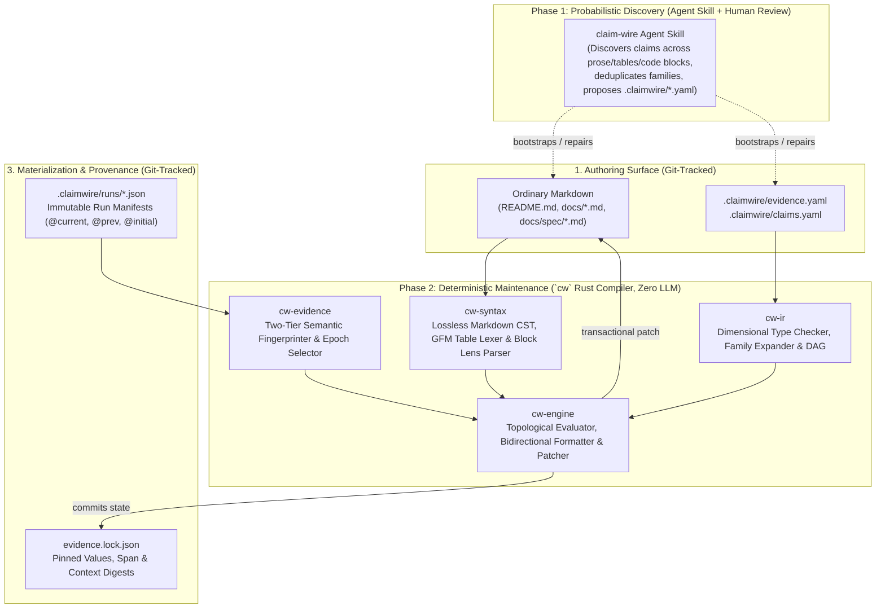

# Claim Wire (`cw`) — Architecture & Technical Specification (`v0.3`)

> **Positioning:** An incremental compiler for evidence-backed repository documentation.
> **Core Principle:** Markdown is a rendering target, not the authoritative store for machine-maintained facts.

---

## 1. First-Principles Problem Analysis

Technical repositories continuously assert empirical and structural facts in Markdown (`README.md`, `docs/BENCHMARKS.md`, `docs/VALIDATION.md`, `docs/spec/*.md`): benchmark latencies, memory footprints, proof/binary sizes, throughput rates, speedup ratios across optimization epochs, test/pass ratios, and mathematical soundness bounds.

Existing approaches fail because they misidentify the abstraction boundary:
1. **Manual synchronization** treats Markdown as the source of truth, leading to silent drift and cross-document contradictions (for example, in `open-magnetar`, `README.md:18` and `docs/BENCHMARKS.md:185` report `227` Python reference tests, while `docs/spec/15-testing.md:12` still says `192 tests`).
2. **Unconstrained AI doc-rewriters** treat documentation maintenance as a text-generation problem. An LLM cannot deterministically answer what code change invalidated which number, and worse, it can silently weaken a claim or acceptance criterion to make prose match a regression.
3. **Naive template generators** destroy readable Markdown by replacing ordinary files with templates (`README.md.tera`) or littering every table cell with hundreds of characters of inline metadata.

### 1.1 The Nine Real-World Bottlenecks ("The Salt")
We stress-tested our specification against **146 tables (1,064 rows) and prose/code blocks across four real repositories** (`open-magnetar` in Rust/Python/C, `cuda-metal` in C++/CUDA/Metal, `arturo-compiler` in Arturo/C++26, and `BatteryUDE.jl` in Julia). Designing Claim Wire from first principles requires solving the nine concrete bottlenecks exposed by those repositories:

| # | Bottleneck | Real-World Failure Case | Claim Wire First-Principles Solution |
|---|---|---|---|
| **1** | **Combinatorial YAML Explosion** | `magnetar` has 15 workloads × 2 profiles × 8 metrics + 12 prover phases across 3 epochs = 300+ values. Scalar YAML declarations would exceed 1,500 lines. | **Parameterized Claim Families (§4.2):** Declare a family once over scope dimensions (`[workload, profile]`); address any cell or derivation as `guest_bench[radix-sort-u64, test].throughput`. |
| **2** | **Markdown Table Clutter & Three Table Orientations** | Wrapping 60 table cells in `<!-- cw:... -->` makes raw Markdown 350 columns wide. Worse, assuming `rows = entities, cols = metrics` breaks on transposed pivot tables (`BENCHMARKS.md:142, 211`) and heterogeneous checklists (`BatteryUDE.jl/README.md:37`). | **Multi-Mode Table Lenses (§5.2):** A single `<!-- cw:table <id> -->` comment above a clean GFM pipe table supports three orientations (`records`, `transposed`, `checklist`) with zero inline HTML inside mapped cells. |
| **3** | **Claims Inside Fenced Code Blocks** | `magnetar/README.md:18` asserts `(362 Rust, 227 Python, 46 ISA tests)` inside a ```` ```sh ```` code block. HTML comments `<!-- cw:... -->` inside ```` ```sh ```` render as visible literal text on GitHub. | **Block Pattern Lenses (§5.3):** Placing `<!-- cw:block <id> -->` *above* a fenced code block (or paragraph/list) binds interior substrings via an invertible line template without injecting HTML comments inside the block. |
| **4** | **GFM Pipe-Table Lexing Traps** | `04-pcs.md:245` has unescaped `\|` inside backticks (`` `2k/\|K\|` ``); `cuda-metal` and `arturo-compiler` have lone `$` signs (`'$L__BB19_1'`, `` `$` ``) in table cells. | **Backtick-Aware GFM Row State Machine (§5.2.1):** Track matching backtick runs (`in_code = tick_count`) and `\|` escapes while never treating `$` as spanning across `\|`. Verified on 1,063/1,064 real rows. |
| **5** | **Non-Uniform Row Keys & Omitted Scope Columns** | `fib(19)` is written as `` `fib(19)` `` (`README.md:44`), `fibonacci, fib(19) = 4181` (`BENCHMARKS.md:18`), and `` `radix-sort-u64` (`A = 17`) `` (`README.md:50`). `BENCHMARKS.md:33` omits the `Profile` column entirely (`test` is implicit). | **Two-Step Key Canonicalization + `default_scope` (§5.2.2):** Strip all inline decorators (`` ` ``, `*`, `_`), strip whitespace-preceded parenthetical notes (`\s+\([^)]*\)$`), apply dimension aliases, and fill omitted dimensions from `default_scope`. |
| **6** | **Cross-Epoch Baselines, Prefix Sums & Subset Sums** | `BENCHMARKS.md:152` compares `@current`, `@prev`, and `@initial` epochs; all 36 `Ends at` cells are cumulative prefix sums of `duration`; `BENCHMARKS.md:222` sums subsets of phases (`register_twist + ram_twist + bytecode_shout = 2.38 s`). | **Named Evidence Epochs (§6.2) + Ordered Family Reductions (§4.4):** Native `@current`/`@prev`/`@initial` epoch addressing, `prefix_sum(duration)`, and subset selectors (`sum(phase_bench[k1, k2].duration)`). |
| **7** | **Sentinel Cells & Prose-Column Numbers** | `BENCHMARKS.md:172, 199` has `—` for unmeasured rows; `13-security.md:56` has `exact`; `BENCHMARKS.md:224` has prose column `Notes on Remaining Gap` citing `(0.79 s)`, `(1.39 s)`, `(0.20 s)`. | **Sentinel Preservation (§5.2.3) + Composable Prose Columns (§5.2.4):** Preserve declared sentinels (`—`, `N/A`, `exact`) when a metric is `null`, and allow inline spans or pattern templates inside unmapped prose columns and headers. |
| **8** | **False Invalidation & Thermal Churn** | Editing a comment in `crates/om-spartan/src/lib.rs` invalidates a 10-minute benchmark; $\pm 2\%$ wall-clock noise causes pointless Git diffs. | **Semantic Token Fingerprinting (§6.3) + Deadband Hysteresis (§6.4):** Strip comments/whitespace before hashing code inputs (`<10 ms` via stat cache); suppress Markdown churn within declared deadband (`2.5%`). |
| **9** | **Surrounding Prose Drift** | A span renders `~491k cycles/s` (`T = 2^22, test`), but someone edits the surrounding sentence to `At T = 2^24 (provable-120)` without touching the span. | **Context Window Anchoring (§8.3):** Lockfile records a normalized `context_digest` of the enclosing sentence/row outside owned spans and raises `CW4002 (Context Drift)` when surrounding qualifiers change. |

---

## 2. System Model & Core Invariants

### 2.1 The Claim Tuple & Dual Graphs
Every tracked statement in a repository is modeled as a five-tuple:
$$\text{Claim} = (\text{Identity}, \text{Type}, \text{Scope}, \text{Derivation / Authority}, \text{Policy})$$

Claim Wire maintains two dual graphs over these claims:
1. **Provenance Graph (Backward / Audit):**
   $$\text{Rendered Bytes} \longrightarrow \text{Invertible Format Pattern} \longrightarrow \text{Claim Node} \longrightarrow \text{Scoped Evidence Record(s)} \longrightarrow \text{Run Manifest + Git SHA + Input Digests}$$
2. **Invalidation Graph (Forward / Incremental Build):**
   $$\text{Modified Source File} \longrightarrow \text{Semantic Input Digest} \longrightarrow \text{Producer (`@current`)} \longrightarrow \text{Claim Family} \longrightarrow \text{Derived Claims & Assertions} \longrightarrow \text{Markdown Spans, Table Cells & Code Blocks}$$

> [!IMPORTANT]
> **Avoiding the Git SHA Circularity Trap:**
> Run manifests record the Git commit SHA for **provenance**, but **freshness** is computed exclusively from the `blake3` digest of the producer's declared input files. Committing an updated `README.md` changes `HEAD` without invalidating any benchmark evidence.

### 2.2 Five Non-Negotiable Invariants
1. **Idempotence:** Running `cw sync` twice with unchanged inputs and evidence produces zero byte changes.
2. **Non-Interference:** `cw` never modifies bytes outside explicitly owned inline spans (`<!-- cw:... -->...<!-- /cw -->`), mapped cells of a `<!-- cw:table ... -->` pipe table, or matched slots of a `<!-- cw:block ... -->` lens. All unregistered prose, whitespace, and line endings are preserved byte-for-byte.
3. **No Silent Weakening:** When an assertion (`assert`) fails—such as a speedup dropping below `1.0×`, a pass ratio dropping from `83/83` to `82/83`, or a proof size exceeding a paper bound—`cw` MUST refuse to publish the broken value or weaken the predicate, halting with diagnostic `CW3002`.
4. **Single-Rounding Determinism:** Intermediate `derive` expressions evaluate in unrounded canonical precision (`i128` scaled rationals / IEEE 754-2008 `f64`), with explicit support for `round(expr, decimals)` when a table derives from rounded display columns. Final formatting rounds (`half_to_even`) strictly at the display boundary.
5. **Crash-Safe Transactionality:** Multi-file Markdown patches and `evidence.lock.json` updates are staged and committed via an atomic write-ahead journal in `.claimwire/.staging/`.

---

## 3. Three-Layer Architecture & Two-Phase Workflow



---

## 4. Normative Specification: Type System, Families & Reductions (`cw-ir`)

### 4.1 Dimensional Type System & Engineering Formats
Every value in Claim IR has a static `ValueType`. Combining incompatible types (e.g., `Duration + Count`) is a compile-time error (`CW2001`).

| `ValueType` | Canonical Storage | Supported Unit Suffixes & Format Modifiers | Dimensional Algebra |
|---|---|---|---|
| `Duration` | `f64` nanoseconds (`ns`) | `ns`, `us`/`µs`, `ms`, `s`, `min`, `auto_time` | `Duration ± Duration -> Duration`<br>`Duration / Duration -> Ratio` |
| `Bytes` | `u64` / `f64` bytes (`B`) | `B`, `KiB` ($2^{10}$), `MiB` ($2^{20}$), `GiB` ($2^{30}$), `KB`, `MB`, `GB`, `auto_iec` | `Bytes ± Bytes -> Bytes`<br>`Bytes / Bytes -> Ratio` |
| `Cycles` | `u64` cycles (`cycles`) | `cycles`, `k cycles` ($10^3$), `M cycles` ($10^6$), `pow2` (`2^22`) | `Cycles / Duration -> Throughput` |
| `Throughput` | `f64` cycles/sec (`cycles/s`) | `cycles/s`, `k cycles/s` ($10^3$), `M cycles/s` ($10^6$) | `Throughput / Throughput -> Ratio` |
| `Count` | `i64` integer | raw (`362`), comma-grouped (`4,194,304`) | `Count ± Count -> Count` |
| `PassRatio` | `(u64, u64)` (`passed, total`) | `{passed}/{total}` (`83/83`, `50/52`), `{rate:.1f}%` | `passed == total -> Bool` |
| `Ratio` / `Float` | `f64` dimensionless | `×` / `x` (`12.5×`), `%` (`27%`), scientific (`{:.3e}`, `1.166e-15`), `neg_pow2` (`2^-120`) | `Ratio * Ratio -> Ratio` |
| `Quantity<U>` | `(f64, UnitTag)` | User-declared domain units (`V`, `mV`, `Ah`, `bits`, `bits/cycle`) | Same-unit `±`, `/` $\rightarrow$ `Ratio` |
| `Bool` | `bool` | `true`/`false`, or mapped (`Yes\|No`, `Accepted\|Rejected`) | `and`, `or`, `not` |
| `String` / `Digest` | UTF-8 / Hex string | literal, `hex8` (`ba7816bf…`) | `==`, `!=` |

### 4.2 Epistemic Primitives & Parameterized Claim Families
`.claimwire/claims.yaml` expresses all tracked facts using four primitives at either the **scalar** or **family** level:
1. **`const` (Declaration):** Maintainer-approved external constant or specification bound (`paper.t22.proof_size_max = 599 KiB`).
2. **`source` / `family` (Observation):** Extracts typed metrics from a producer's run manifest, indexed by structured `dimensions` (`[workload, profile]`, `[phase]`, `[case]`).
3. **`derive` (Derivation):** Pure mathematical expression over claims, family metrics, or cross-epoch references (`@current`, `@prev`, `@initial`).
4. **`assert` (Verification):** Boolean invariant that must evaluate to `true` for dependent bindings to verify or sync.

### 4.3 Claim Addressing Grammar
```ebnf
ClaimRef   ::= FamilyOrId ("@" EpochId)? ("[" SelectorList "]")? ("." FieldId)? ;
FamilyOrId ::= Identifier ("." Identifier)* ;
EpochId    ::= "current" | "prev" | "initial" | Identifier ;
SelectorList ::= "*" | (KeyVal ("," Whitespace? KeyVal)*) ;
KeyVal     ::= Identifier | QuotedString | Integer ;
```

### 4.4 Family Reductions & Ordered Aggregations
Real benchmark tables frequently aggregate across rows of a family (verified on `magnetar/docs/BENCHMARKS.md` L152 and L222):
- **Total Aggregation (`sum`, `min`, `max`):**
  - `sum(phase_bench[*].duration)` $\rightarrow$ sums `duration` across all 12 phases (`8.76 s` at `@current`, `20.62 s` at `@prev`).
  - `min(soundness_ledger[*].per_round_bits)` $\rightarrow$ `120.0` (used to assert `>= 120.0` across all 40 ledger rows in `13-security.md`).
- **Subset Aggregation (`sum(family[k1, k2, ...].metric)`):**
  - `sum(phase_bench[register_twist, ram_twist, bytecode_shout].duration)` $\rightarrow$ `0.79 s + 1.39 s + 0.20 s = 2.38 s` (`Twist & Shout` in `BENCHMARKS.md:224`).
  - `sum(phase_bench[execute, packed_witness, component_witnesses, build_g, routers].duration)` $\rightarrow$ `1.69 s` (`Execute + Witness + Routers` in `BENCHMARKS.md:226`).
- **Ordered Prefix Sum (`prefix_sum(metric)`):**
  - Evaluates the running cumulative sum of `metric` in the manifest's sequence order. In `BENCHMARKS.md:152`, `ends_at: "prefix_sum(duration)"` automatically computes all 36 `Ends at` cells across `@current` (`0.76 s, 0.89 s, ..., 8.76 s`), `@prev` (`0.75 s, ..., 20.62 s`), and `@initial` (`0.8 s, ..., 107.0 s`).

---

## 5. Normative Specification: Lossless Markdown, Table Lenses & Block Lenses (`cw-syntax`)

### 5.1 Inline Span Grammar (`<!-- cw:... -->...<!-- /cw -->`)
For numbers embedded in ordinary prose paragraphs, Claim Wire uses standard HTML comments with a universal short closing tag `<!-- /cw -->`:
```markdown
That made <!-- cw:inventory.table1_proved -->11<!-- /cw --> of the <!-- cw:inventory.table1_workloads -->15<!-- /cw --> Table 1 workloads proved end to end.

At `T = 2^22`, throughput is **<!-- cw:guest_bench[radix-sort-u64, test].throughput -->~491k cycles/s<!-- /cw -->** (`test`)
and **<!-- cw:guest_bench[radix-sort-u64, provable-120].throughput -->~476k cycles/s<!-- /cw -->** (`provable-120`).
```

### 5.2 Multi-Mode Table Lenses (`<!-- cw:table <lens-id> -->`)
Placing `<!-- cw:table <lens-id> -->` immediately above a GFM pipe table binds the table without injecting HTML comments inside mapped cells. Claim Wire supports three table orientations:

1. **`mode: records` (Row-per-Entity Relational Table — Default):**
   - Rows identify scope keys (`[Guest, Profile]` or `[Phase]`); columns map to metric templates (`Prove`, `Peak RSS`, `Verify`, `Proof Size`).
   - Supports `default_scope: { profile: test }` when a dimension column is omitted from the table (e.g., `BENCHMARKS.md:33` and `BENCHMARKS.md:52`).
2. **`mode: transposed` (Metric-per-Row Pivot Table):**
   - Rows identify distinct metrics (`T (cycles, padded)`, `Prove (wall)`, `Peak memory`, `Verify`, `Proof size`), each with its own type and template; columns identify scopes or epochs (`provable-120`, `test`, `Previous`, `Initial`), solving `BENCHMARKS.md:142` and `BENCHMARKS.md:211`.
3. **`mode: checklist` (Heterogeneous Verification Table):**
   - Each row key maps to an independent scalar/family claim and assertion template (solving `BENCHMARKS.md:182` `Test suites`, `VALIDATION.md:30`, `cuda-metal/docs/status.md`, and `BatteryUDE.jl/README.md:37`).

#### 5.2.1 Normative GFM Table Row Lexer State Machine
To parse real-world scientific and systems tables reliably, row splitting MUST NOT use naive `.split('|')` or treat `$` as a multi-cell delimiter:
- Strip leading and trailing row border pipes (`|`).
- Scan UTF-8 bytes left-to-right maintaining `in_code_ticks: usize`:
  - On `\` followed by any character: consume both bytes as part of the cell (`\|` is an escaped pipe).
  - On a run of $k \ge 1$ consecutive backticks (`` ` ``): if `in_code_ticks == 0`, set `in_code_ticks = k`; else if `in_code_ticks == k`, set `in_code_ticks = 0`.
  - On `|` when `in_code_ticks == 0`: end current cell and start next cell.
  - Dollar signs (`$`) NEVER mask `|` delimiters (preventing assembly labels like `$L__BB19_1` or symbol names like `` `$` `` from corrupting column counts).

#### 5.2.2 Two-Step Key Canonicalization & Decorator Preservation
When resolving a key cell (e.g., `` `radix-sort-u64` (`A = 17`) `` or `fibonacci, fib(19) = 4181`) against a dimension (`workload`) or row map:
1. **Step 1 (Decorator Strip):** Remove all inline Markdown emphasis/code characters (`` ` ``, `*`, `_`) and trim whitespace $\rightarrow$ `radix-sort-u64 (A = 17)`. Match against canonical keys and declared `aliases`.
2. **Step 2 (Parenthetical Qualifier Strip):** If still unresolved, strip trailing parenthetical qualifiers preceded by at least one whitespace character (`\s+\([^)]*\)$`) $\rightarrow$ `radix-sort-u64` (preserving function-call identifiers like `fib(19)` and `sha256("abc")` that have no space before `(`), then match against canonical keys and `aliases`.
3. **Decorator Preservation on Write:** When updating a mapped value cell, if the existing cell is wrapped in outer bold (`**8.55 s**`) or inline code ticks (`` `2^22` ``) and the template does not explicitly include `*` or `` ` ``, the engine preserves the existing outer decorator automatically.

#### 5.2.3 Sentinel Cell Handling (`sentinels`)
Benchmark and specification tables frequently contain sentinel markers for unmeasured or exact entries (`—` in `BENCHMARKS.md:172, 199–201`, `exact` in `13-security.md:56`, `N/A ($t = 8$)` in `BENCHMARKS.md:218`).
- When a table lens declares `sentinels: ["—", "exact", "N/A ($t = 8$)"]` (the default set includes `"—"` and `"N/A"`), if the underlying evidence record is absent (`null`) or flagged `exact`, `cw` verifies that the cell contains an allowed sentinel and preserves it without emitting `CW2104`.

#### 5.2.4 Composable Prose Columns & Header Templates
Inside a `<!-- cw:table <id> -->` table:
- Any cell in an **unmapped column** (such as `Notes on Remaining Gap` in `BENCHMARKS.md:224` or `Gap / Status` in `BENCHMARKS.md:213`) and any **header cell** (`Previous (20.62 s)`) is still scanned for inline `<!-- cw:... -->` spans OR matched against optional `cell_patterns` declared on the table lens.

### 5.3 Block Pattern Lenses (`<!-- cw:block <id> -->`) for Code Blocks & Clean Prose
Putting `<!-- cw:... -->` inside a fenced code block (```` ```sh ````) is forbidden because CommonMark renders HTML comments inside code blocks as visible text.
To wire numbers inside fenced code blocks (such as `README.md:18`) or keep prose paragraphs/lists completely free of inline HTML comments:
```markdown
<!-- cw:block readme.test_suite_comment -->
```sh
# Run Rust, Python, and RV64I conformance + fuzz suites (362 Rust, 227 Python, 46 ISA tests)
cargo test --workspace --release
```
```
In `.claimwire/claims.yaml`:
```yaml
blocks:
  readme.test_suite_comment:
    file: README.md
    lines:
      - "# Run Rust, Python, and RV64I conformance + fuzz suites ({inventory.rust_tests} Rust, {inventory.python_tests} Python, {inventory.isa_tests} ISA tests)"
```
The compiler compiles each line pattern into an unambiguous prefix/infix/suffix matcher (`"# Run Rust, Python, and RV64I conformance + fuzz suites ("` ... `" Rust, "` ... `" Python, "` ... `" ISA tests)"`), locates the matching line inside the block immediately following `<!-- cw:block readme.test_suite_comment -->`, and updates `362`, `227`, and `46` in place.

---

## 6. Normative Specification: Evidence Store, Epochs & Fingerprinting (`cw-evidence`)

### 6.1 Named Evidence Epochs (`@current`, `@prev`, `@initial`)
Producers bind immutable run manifests to named epochs in `.claimwire/evidence.yaml`:
- **`@current`:** Verified against the working tree's semantic `input_set_digest` during `cw check`. If tracked source inputs change, `@current` is flagged `StaleInputs` (`CW3001`).
- **Historical Epochs (`@prev`, `@initial`):** Pinned snapshots of prior optimization milestones (`107 s`, `20.7 s`). Exempt from current-tree input staleness checks, while providing full provenance for historical comparison columns and speedup derivations (`12.5×`, `6.06×`).

### 6.2 Fast Two-Tier Semantic Input Fingerprinting
1. **Tier 1 (Stat Cache):** Look up `(rel_path, mtime_ns, byte_len)` in `.claimwire/.cache/fingerprints.bin`. On hit, return cached `semantic_blake3` in $O(1)$ without reading the file (`< 10 ms` full-workspace `cw check`).
2. **Tier 2 (Lexical Token Normalizer):** On cache miss, stream `.rs`, `.c`, `.h`, `.py`, `.jl` files through a state machine that strips line/block comments and collapses non-semantic whitespace outside string literals before hashing with `blake3`. Fixing a typo in a doc-comment or running `cargo fmt` never invalidates benchmark runs.

### 6.3 Statistical Hysteresis (`deadband`)
- **Deterministic Metrics (`Bytes`, `Cycles`, `Count`, `PassRatio`, `Digest`):** Default `deadband: 0%`. Any 1-byte proof size change or 1-test count change is caught immediately.
- **Empirical Timing / Memory Metrics (`Duration`, `Peak RSS`):** Can declare `deadband: 2.5%`. When a new run is within $\pm 2.5\%$ of the locked value and all `assert` guards pass, `cw` avoids churning the Markdown file unless `--exact` is passed.

### 6.4 The `@cw:` Stdout Wire Protocol (`cw capture`)
Any benchmark or test binary can emit single-line telemetry frames to stdout/stderr without linking an SDK:
```text
@cw:record family="guest_bench" workload="radix-sort-u64" profile="test" cycles=4194304 prove_wall="8.55s" peak_rss="8.3GiB" verify_wall="10ms" proof_size="60806B"
```
`cw capture --producer om.benchmarks -- <cmd>` intercepts `@cw:` lines, records OS/CPU/RAM metadata, Git commit SHA, and semantic input digests, and writes `.claimwire/runs/bench-current.json` atomically.

---

## 7. Complete Example: `.claimwire/claims.yaml` for `magnetar`

```yaml
schema: claimwire/v1

aliases:
  workload:
    "fib(19)": ["fibonacci, fib(19) = 4181"]
    "sha256":  ['sha256("abc")', 'sha256 of "abc"']
  phase:
    "ram_twist":     ["RAM Twist"]
    "ligerito_open": ["ring switching + Ligerito open"]

constants:
  paper.t22.proof_size_max: { type: Bytes, value: "599 KiB" }
  paper.t22.verify_ms:      { type: Duration, value: "13 ms" }
  paper.t22.soundness_bits: { type: Quantity<bits>, value: "120.0 bits" }

families:
  guest_bench:
    producer: om.benchmarks
    dimensions: [workload, profile]
    metrics:
      cycles:      { type: Cycles,   format: "{:,}" }
      prove_wall:  { type: Duration, format: "{:.2f} s", deadband: 2.5% }
      prove_cpu:   { type: Duration, format: "{:.1f} s", deadband: 2.5% }
      peak_rss:    { type: Bytes,    format: "{:auto_iec}", deadband: 2.0% }
      heap_peak:   { type: Bytes,    format: "{:auto_iec}", deadband: 2.0% }
      verify_wall: { type: Duration, format: "{:.0f} ms", deadband: 5.0% }
      verify_cpu:  { type: Duration, format: "{:.0f} ms", deadband: 5.0% }
      verify_rss:  { type: Bytes,    format: "{:.1f} MiB", deadband: 2.0% }
      proof_size:  { type: Bytes,    format: "{:,} B" }
    derivations:
      throughput:
        type: Throughput
        expr: "cycles / prove_wall"
        format: "~{:.0f k cycles/s}"
      speedup_vs_initial:
        type: Ratio
        expr: "guest_bench@initial[workload, test].prove_wall / prove_wall"
        format: "{:.1f}×"
      paper_size_gap:
        type: Bytes
        expr: "paper.t22.proof_size_max - proof_size"
        format: "~{:.0f KiB}"

  phase_bench:
    producer: om.benchmarks
    dimensions: [phase]
    metrics:
      duration:  { type: Duration, format: "{:.2f} s", deadband: 2.5% }
      heap_peak: { type: Bytes,    format: "{:.1f} GiB", deadband: 2.0% }
    derivations:
      ends_at:
        type: Duration
        expr: "prefix_sum(duration)"
        format: "{:.2f} s"
      share_of_total:
        type: Ratio
        expr: "duration / sum(phase_bench[*].duration)"
        format: "{:.0f}%"
      speedup_vs_prev:
        type: Ratio
        expr: "phase_bench@prev[phase].duration / duration"
        format: "{:.2f}×"

claims:
  inventory.rust_crates:      { kind: source, producer: om.inventory, metric: rust_crates, type: Count }
  inventory.vector_files:     { kind: source, producer: om.inventory, metric: vector_files, type: Count }
  inventory.table1_workloads: { kind: source, producer: om.inventory, metric: table1_workloads, type: Count }
  inventory.rust_tests:       { kind: source, producer: om.inventory, metric: rust_tests, type: Count }
  inventory.python_tests:     { kind: source, producer: om.inventory, metric: python_tests, type: Count }
  inventory.isa_tests:        { kind: source, producer: om.inventory, metric: isa_tests, type: Count }
  inventory.oracle_cases:     { kind: source, producer: om.inventory, metric: oracle_cases, type: Count }

assertions:
  check.rs_faster_than_initial:
    expr: "guest_bench[radix-sort-u64, test].speedup_vs_initial > 1.0"
  check.proof_ahead_of_paper:
    expr: "guest_bench[radix-sort-u64, provable-120].proof_size <= paper.t22.proof_size_max"
  check.soundness_120:
    expr: "min(soundness_ledger[*].per_round_bits) >= paper.t22.soundness_bits"

blocks:
  readme.test_suite_comment:
    file: README.md
    lines:
      - "# Run Rust, Python, and RV64I conformance + fuzz suites ({inventory.rust_tests} Rust, {inventory.python_tests} Python, {inventory.isa_tests} ISA tests)"

tables:
  readme.benchmarks:
    file: README.md
    mode: records
    family: guest_bench
    key_columns: { Guest: workload, Profile: profile }
    columns:
      "Cycles (`T`)": "{cycles:pow2}"
      "Prove": "{prove_wall:.2f s}"
      "Peak RSS": "{peak_rss:auto_iec}"
      "Verify": "{verify_wall:.0f ms}"
      "Proof Size": "{proof_size:, B}"
    row_overrides:
      "[radix-sort-u64, test]":
        "Verify": "{verify_wall:.0f ms} ({verify_rss:.0f MiB})"
      "[radix-sort-u64, provable-120]":
        "Verify": "{verify_wall:.0f ms} ({verify_rss:.0f MiB})"
        "Proof Size": "{proof_size:, B} ({proof_size:.1f KiB})"

  bench.radix_sort_deep_dive:
    file: docs/BENCHMARKS.md
    mode: transposed
    key_column: Quantity
    column_scopes:
      "`provable-120` (`t = 177, gs = 2`)": { family: guest_bench, epoch: current, scope: [radix-sort-u64, provable-120] }
      "`test` (`t = 8`)":                   { family: guest_bench, epoch: current, scope: [radix-sort-u64, test] }
      "Initial `test` baseline":            { family: guest_bench, epoch: initial, scope: [radix-sort-u64, test] }
    rows:
      "T (cycles, padded)": "{cycles:,}"
      "Prove (wall)":       "**{prove_wall:.2f s}** (≈ {throughput:.0f k cycles/s}; {prove_cpu:.1f s} CPU)"
      "Peak memory":        "{peak_rss:.1f GiB} footprint ({heap_peak:.1f GiB} heap peak)"
      "Verify":             "{verify_wall:.0f ms} wall, {verify_cpu:.0f ms} CPU, {verify_rss:.1f MiB} RSS"
      "Proof size":         "{proof_size:, B}"
```

---

## 8. Provenance Lockfile & Conflict / Context Detection (`evidence.lock.json`)

### 8.1 Lockfile Schema
```json
{
  "schema": "claimwire-lock/v3",
  "producers": {
    "om.benchmarks": {
      "epochs": {
        "current": {
          "run_id": "bench-20261016-m4pro",
          "git_commit": "9872a7e",
          "input_set_digest": "blake3:7f83b1657ff1fc53b92dc18148a1d65dfc2d4b1fa3d677284addd200126d9069"
        },
        "prev": { "run_id": "bench-20261015-m4pro", "git_commit": "412c90a", "input_set_digest": "blake3:2c91a402..." },
        "initial": { "run_id": "bench-20261014-m4pro", "git_commit": "109a8b2", "input_set_digest": "blake3:88e1f019..." }
      }
    }
  },
  "evaluated_claims": {
    "guest_bench[radix-sort-u64, test].prove_wall": { "value": 8.55, "unit": "s", "epoch": "current" },
    "guest_bench[radix-sort-u64, test].throughput": { "value": 490561.8713450292, "unit": "cycles/s" },
    "guest_bench[radix-sort-u64, test].speedup_vs_initial": { "value": 12.514619883040936, "unit": "ratio" }
  },
  "locations": {
    "README.md::block:readme.test_suite_comment#0": {
      "rendered": "# Run Rust, Python, and RV64I conformance + fuzz suites (362 Rust, 227 Python, 46 ISA tests)",
      "rendered_digest": "blake3:5f2d9c...",
      "context_digest": "blake3:11a08e..."
    },
    "README.md::table:readme.benchmarks::[radix-sort-u64, test]::Prove": {
      "rendered": "**8.55 s**",
      "rendered_digest": "blake3:31a9e0...",
      "context_digest": "blake3:90f4b2..."
    },
    "README.md::span:guest_bench[radix-sort-u64, test].throughput#0": {
      "rendered": "~491k cycles/s",
      "rendered_digest": "blake3:a44c12...",
      "context_digest": "blake3:71e80d..."
    }
  }
}
```

### 8.2 Manual Edit Conflict Detection (`CW4001`)
Before `cw sync` overwrites any inline span, table cell, or block pattern line, it hashes the current bytes in the Markdown file and compares against `locations[loc].rendered_digest` in `evidence.lock.json`:
- If `current_markdown_digest != lockfile.rendered_digest`, a human has hand-edited the owned value in Markdown outside Claim Wire.
- `cw` aborts with `CW4001 (Manual Edit Conflict)` and prints the diff, requiring `--force` to restore from evidence.

### 8.3 Context Window Anchoring (`CW4002`)
For every inline span and table row, `context_digest` hashes the normalized text of the enclosing sentence/line (excluding owned spans).
- If a developer edits `At T = 2^22, throughput is ... (test)` to `At T = 2^24, throughput is ... (test)`, `context_digest` changes while the span binding still points to `T = 2^22`.
- `cw check` emits `CW4002 (Surrounding Context Drift)` so the author either updates the binding or acknowledges the prose edit (`cw sync --ack-context`).

---

## 9. Compiler Pipeline, CLI & Diagnostics (`cw-cli`)

### 9.1 Seven-Stage Deterministic Pipeline
1. **01 Lex (`cw-syntax`):** Scan Markdown files into tokens (`Text`, `CodeFence`, `InlineCode`, `InlineSpan`, `TableLens`, `BlockLens`, `PipeTable`), respecting fenced code boundaries and the backtick-aware GFM row lexer (§5.2.1).
2. **02 Parse (`cw-syntax`):** Build lossless byte-span CSTs for Markdown files and deserialize `.claimwire/*.yaml` with line/column source locations.
3. **03 Expand & Resolve (`cw-ir`):** Expand parameterized claim families across evidence records, canonicalize table keys (§5.2.2), resolve cross-epoch references and family reductions (`sum`, `prefix_sum`, `min`, `max`), and topologically sort the DAG (rejecting cycles with `CW2002`).
4. **04 Type & Scope Check (`cw-ir` + `cw-evidence`):** Enforce dimensional algebra (`CW2001`), scope compatibility (`CW2004`), and semantic input fingerprint freshness (`CW3001`).
5. **05 Evaluate (`cw-engine`):** Evaluate `source`, `derive`, and `assert` nodes in topological order; check deadband hysteresis against `evidence.lock.json`.
6. **06 Lower & Audit (`cw-engine`):** Format values through bidirectional format patterns (preserving sentinels and outer decorators); verify `rendered_digest` (`CW4001`) and `context_digest` (`CW4002`).
7. **07 Transactional Patch (`cw-engine`):** Write updated Markdown files and `evidence.lock.json` via `.claimwire/.staging/journal.json`.

### 9.2 CLI Subcommands

| Command | Purpose |
|---|---|
| `cw check [--format human\|json\|github\|sarif]` | Read-only CI/local check. Validates syntax, types, scopes, input freshness, assertions, and byte-exact agreement between Markdown and `evidence.lock.json`. |
| `cw sync [--exact] [--force] [--ack-context]` | Recomputes claims and updates owned Markdown spans, table lens cells, block lenses, and `evidence.lock.json`. |
| `cw capture --producer <id> -- <cmd...>` | Runs `<cmd>`, captures `@cw:record` telemetry lines, fingerprints inputs, and writes a new run manifest. |
| `cw impact [<path...> \| --git-diff <rev>]` | Traces modified source files forward through the invalidation graph to list affected producers, claims, and exact `file:line` Markdown locations. |
| `cw explain <location-or-claim>` | Prints the full provenance tree for any claim, span, or `file:line` coordinates. |
| `cw diff <rev1>..<rev2>` | Compares claim states across Git revisions, classifying changes into **Value Changed**, **Definition Changed**, **Scope Changed**, **Evidence Refreshed**, or **Assertion Regressed**. |
| `cw adopt [<file...>]` | Reverse-parses existing Markdown spans, table cells, and block lenses using bidirectional format strings to initialize `evidence.lock.json` without modifying Markdown bytes. |
| `cw merge-driver %O %A %B` | Custom Git merge driver that resolves `evidence.lock.json` and wired Markdown conflicts structurally. |

### 9.3 Diagnostic Code Taxonomy

| Range | Category | Key Codes |
|---|---|---|
| `CW1xxx` | Syntax & CST | `CW1001` Malformed marker · `CW1002` Nested span · `CW1003` Mismatched close tag · `CW1004` Unclosed span · `CW1005` Malformed GFM table under `cw:table` · `CW1006` Unmatched `cw:block` line pattern |
| `CW2xxx` | Types & Scope | `CW2001` Dimensional unit mismatch · `CW2002` Dependency cycle · `CW2003` Unresolved claim/table key · `CW2004` Incompatible scope in derivation · `CW2104` Missing evidence record for non-sentinel cell |
| `CW3xxx` | Verification & Freshness | `CW3001` Stale evidence (semantic input digest changed) · `CW3002` Assertion failed (`assert` is `false`) · `CW3003` Markdown value out of sync with claim |
| `CW4xxx` | Conflict & Context | `CW4001` Unapproved manual edit inside owned span/cell/block · `CW4002` Surrounding prose context drifted from locked `context_digest` |

---

## 10. First Test Environment & 10-Point Acceptance Suite (`tests/fixtures/magnetar`)

The first test environment copies `../magnetar`'s Markdown files (`README.md`, `docs/BENCHMARKS.md`, `docs/VALIDATION.md`, `docs/spec/13-security.md`, `docs/spec/15-testing.md`) into `tests/fixtures/magnetar/` and wires five complete claim families:
1. **`guest_bench[workload, profile]`** across all 15 RV64I workloads and 3 epochs (`@initial`, `@prev`, `@current`), feeding `README.md` (`readme.benchmarks` table + throughput prose) and `docs/BENCHMARKS.md` (5 tables including the transposed deep-dive and paper comparison tables).
2. **`phase_bench[phase]`** across all 12 `OM_TRACE` prover phases, computing all 36 `Ends at` cells via `prefix_sum(duration)` and deriving the 6 grouped prover phase shares (`27%`, `19%`, `19%`, `18%`, `14%`, `3%`) and speedups (`1.55×`, `6.06×`, `8.19×`).
3. **`validation_vec[case]`** across the RFC 6234 SHA-256 public vectors (`empty`, `abc`, `message56`) in `docs/VALIDATION.md`.
4. **`soundness_ledger[row]`** across the 40-row RBR soundness ledger in `docs/spec/13-security.md` (with `exact` sentinel preservation on rows 5 and 19, and `min(per_round_bits) >= 120.0`).
5. **`inventory.*`** across Rust tests (`362`), Python tests (`227`), ISA conformance tests (`46`), oracle cases (`47`), test vector files (`27`), Rust crates (`16`), and Table 1 workloads (`15`).

### 10.1 Real-World Drift Catch in `magnetar` (`docs/spec/15-testing.md:12`)
Micro-testing `magnetar` revealed an actual live documentation drift:
- `README.md:18` (via `cw:block`) and `docs/BENCHMARKS.md:185` (via `cw:table`) state **`227`** Python reference tests.
- `docs/spec/15-testing.md:12` states `(192 tests, about one minute)`.
Wiring `docs/spec/15-testing.md:12` to `inventory.python_tests` immediately demonstrates `cw check` catching the `192 != 227` (`CW3003`) discrepancy and `cw sync` repairing it to `227`.

### 10.2 10-Point Automated Verification Matrix
1. **Zero-Diff Adoption & Live Drift Detection (`cw adopt` + `cw check`):** Bidirectional format parsing verifies all synced `magnetar` tables/blocks/spans with 0 byte diffs on existing prose, while immediately flagging the real `192 vs 227` drift in `docs/spec/15-testing.md:12`.
2. **Multi-Table, Transposed & Multi-Doc Fan-Out (`cw sync`):** Updating `guest_bench[radix-sort-u64, test].prove_wall` from `8.55 s` to `7.90 s` updates `README.md` (`records` table + prose) and `docs/BENCHMARKS.md` (`transposed` deep-dive table + paper comparison table + prose), and recomputes throughput (`~491k` $\rightarrow$ `~531k cycles/s`) and speedup (`12.5×` $\rightarrow$ `13.5×`) everywhere.
3. **Ordered Prefix-Sum & Subset-Sum Cascade:** Updating `phase_bench[virtual_spartan].duration` from `1.54 s` to `1.20 s` automatically updates all 7 downstream `Ends at` cells in `BENCHMARKS.md:159–165`, the total wall time (`8.76 s` $\rightarrow$ `8.42 s`), and all 6 phase shares and speedups in `BENCHMARKS.md:222–229`.
4. **Idempotence:** A second `cw sync` is a strict no-op (`0` files written).
5. **Semantic Fingerprint Immunity:** Adding a `// comment` or formatting whitespace in `crates/om-spartan/src/lib.rs` leaves the semantic input digest unchanged (`cw check` passes in `< 10 ms` with `0` stale claims).
6. **True Code Invalidation (`cw impact`):** Modifying code in `crates/om-spartan/src/lib.rs` triggers `CW3001 (Stale Evidence)` on `om.benchmarks` and lists every affected table, block, and span across `README.md` and `docs/BENCHMARKS.md`.
7. **Deadband Hysteresis & Sentinel Preservation:** Recording `8.60 s` ($+0.58\%$, within `deadband: 2.5%`) passes `cw check` without churning `README.md`, `—` and `exact` sentinel cells are preserved untouched, and changing deterministic `proof_size` by 1 byte (`603,942 B` $\rightarrow$ `603,943 B`, `deadband: 0%`) triggers an immediate update.
8. **Assertion Guard Refusal (`CW3002`):** Setting `provable-120` proof size to `620,000 B` ($> 599\text{ KiB}$) blocks `cw sync` with `CW3002` and refuses to publish the broken `"Ahead of paper"` comparison.
9. **Manual Edit Conflict (`CW4001`) & Context Drift (`CW4002`):** Hand-editing `8.55 s` to `5.00 s` in `README.md` triggers `CW4001`; editing `At T = 2^22` to `At T = 2^24` around the throughput span in `README.md:53` triggers `CW4002`.
10. **Full Provenance Trace (`cw explain`):** `cw explain README.md:53` prints the complete derivation and multi-epoch provenance chain (`4,194,304 cycles / 8.55 s`, run `bench-20261016-m4pro`, commit `9872a7e`).

---

## 11. Workspace & Crate Layout

```text
claim-wire/
├── Cargo.toml
├── spec.md
├── crates/
│   ├── cw-syntax/       # Lossless Markdown CST, backtick-aware GFM table lexer, block lens & bidirectional format parser
│   ├── cw-ir/           # Dimensional type checker, family/reduction expander (sum, prefix_sum), scope & epoch DAG resolver
│   ├── cw-evidence/     # Two-tier semantic fingerprinter, epoch manifest loader, @cw: wire protocol capture
│   ├── cw-engine/       # Topological evaluator, deadband/sentinel handler, context/edit conflict auditor, atomic patcher
│   └── cw-cli/          # `cw` binary (`check`, `sync`, `capture`, `impact`, `explain`, `diff`, `adopt`, `merge-driver`)
├── skills/
│   └── claim-wire/
│       └── SKILL.md     # Agent skill for discovery, family deduplication, table/block lens wiring, and CWxxxx repair
└── tests/
    └── fixtures/
        └── magnetar/    # Full end-to-end test environment built from ../magnetar's Markdown files
```
